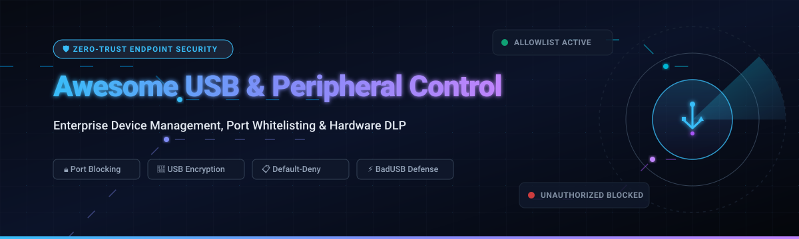
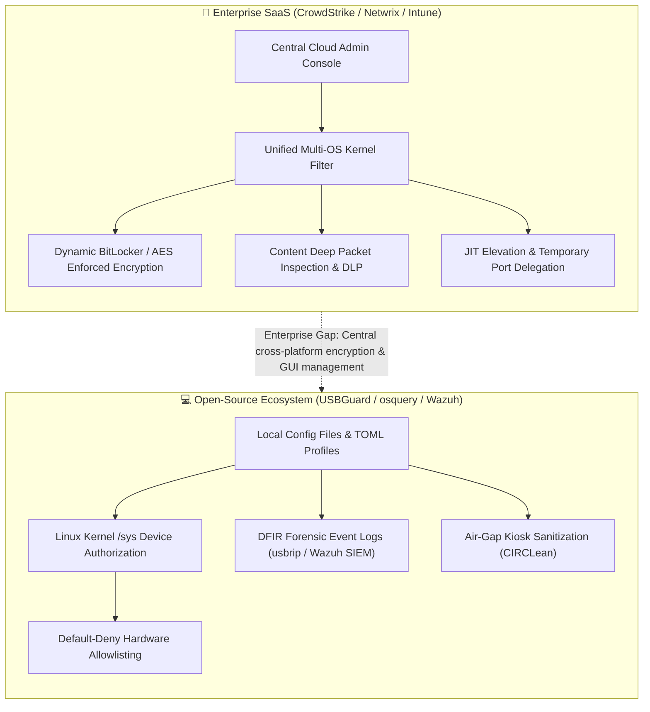

# 🛡️ Awesome USB & Peripheral Device Control ⚡

**A curated index of top-tier SaaS platforms, enterprise port control solutions, and open-source cybersecurity repositories for peripheral device authorization, hardware DLP, and removable media protection.**

---

## 📖 Executive Summary & Scope

Modern endpoint security architectures must account for physical hardware interfaces just as rigorously as network perimeters. Unauthorized USB flash drives, peripheral docking stations, external storage controllers, and rogue microcontrollers (such as BadUSB or Rubber Ducky devices) represent prime attack vectors for **air-gapped exfiltration, malware injection, firmware tampering, and physical data loss**.

This repository tracks **enterprise SaaS products** and **open-source GitHub security tools** engineered for:
- 🔒 **Granular Port Whitelisting & Device Authorization**: Enforcing default-deny policies by Vendor ID (VID), Product ID (PID), device class, GUID, and device serial numbers.
- 💾 **Removable Media Encryption & File Shadowing**: Enforcing BitLocker or proprietary container encryption on unapproved flash drives, alongside byte-level file copy auditing.
- 🚫 **BadUSB & HID Spoofing Mitigation**: Detecting rapid automated keystroke injection and restricting rogue human-interface device emulation.
- 📊 **Centralized Policy Compliance**: Meeting international cybersecurity standards including ISO/IEC 27001, NIST SP 800-53, HIPAA, PCI-DSS v4.0, and CMMC.

---

## 📑 Table of Contents

- [🌐 Sector Overview & Market Dynamics](#-sector-overview--market-dynamics)
- [🏢 Enterprise SaaS & Commercial Platforms](#-enterprise-saas--commercial-platforms)
- [💻 Open-Source GitHub Projects](#-open-source-github-projects)
- [🛠️ Architectural Comparison: SaaS vs. FOSS](#️-architectural-comparison-saas-vs-foss)
- [💖 Support & Sponsorship](#-support--sponsorship)
- [⭐ Star History](#-star-history)
- [🤝 How to Contribute](#-how-to-contribute)
- [⚠️ Disclaimer](#️-disclaimer)

---

## 🌐 Sector Overview & Market Dynamics

> [!NOTE]
> **Market Size & Valuation:** The global **Endpoint Security Software market** is valued at approximately **$21B to $24B**, projected to surpass **$38B to $50B by 2030** with an annual growth rate (CAGR) of **10% to 14%**, bolstered directly by hardware data loss prevention (DLP) and zero-trust port access mandates. Concurrently, the physical **USB device and peripheral interface hardware market** exceeds **$41B**, scaling past **$75B by 2030** driven by USB-C/Thunderbolt ubiquity.
>
> **Market Concentration:** The enterprise endpoint device control sector is **moderately concentrated among consolidated hyperscalers and mega-cap cybersecurity vendors** (Microsoft, CrowdStrike, Broadcom/Symantec, and Trellix), who bundle peripheral management inside unified XDR/EDR agents. However, a thriving specialized tier of dedicated DLP and port management vendors (such as CoSoSys/Netwrix, ManageEngine, and DriveLock) commands essential market share across defense, healthcare, and air-gapped critical infrastructure where granular byte-level file shadowing and hardware-enforced encryption are mandatory.

---

## 🏢 Enterprise SaaS & Commercial Platforms

The following table indexes leading commercial solutions for USB, Thunderbolt, Bluetooth, and peripheral security, sorted in descending order by **Company Scale (Market Capitalization / Enterprise Valuation / Annual Revenue)**.

| 🏢 Platform | 🏢 Company Scale (Market Cap / Revenue) | 🏷️ Starting Tier Pricing | 🎁 Free Tier / Trial Limits | 🛡️ Key Device Control Capabilities |
| :--- | :--- | :--- | :--- | :--- |
| **[Microsoft Intune Device Control](https://learn.microsoft.com/)** | **~$3.1 Trillion** *(Market Cap)* | **$8.00** per user/month *(Plan 1 Standalone, billed annually)* | **30-Day Free Trial** *(Full EMS tenant with up to 25 evaluation user licenses)* | Native Defender device control policies on Windows endpoints; Allow/Deny by device class, hardware ID, and SID-based exemptions. |
| **[Symantec Endpoint Security / Device Control](https://www.broadcom.com/)** | **~$800+ Billion** *(Broadcom Market Cap)* | **~$16.00 to $20.00** per device/year *(SEP / SES Enterprise base tier)* | **No public self-service trial** *(Enterprise PoC via authorized Broadcom distributor)* | Enterprise policy enforcement by GUID class or hardware ID, automatic Device Manager hardware disabling, and registry inspection. |
| **[CrowdStrike Falcon Device Control](https://www.crowdstrike.com/)** | **~$100+ Billion** *(Market Cap)* | **$29.99 to $59.99** per device/year *(Included in Falcon Go entry tier)* | **15-Day Free Trial** *(Zero upfront credit card; full access to Falcon Device Control & Prevent)* | Unified lightweight kernel agent; granular USB visibility, automated write-blocking, source code exfiltration detection across 40+ languages. |
| **[ManageEngine Device Control Plus](https://www.manageengine.com/)** | **~$1.2 Billion+** *(Zoho Corp Annual Revenue)* | **$595.00** per year *(Professional tier for 100 computers, single technician)* | **Free Forever Edition up to 25 endpoints** *(or 30-Day full feature trial with unlimited endpoints)* | Allowed > Trusted > Blocked hierarchical permissions, temporary device delegation, strict file-size limits, and complete USB file shadowing. |
| **[Sophos Central Intercept X Device Control](https://www.sophos.com/)** | **~$1.1+ Billion** *(Annual Revenue)* | **~$28.00 to $45.00** per user/year *(Core Intercept X Advanced tier)* | **30-Day Free Trial** *(Up to 1,000 trial directory objects with complete central management)* | Centralized port and peripheral access policy management; blocks non-compliant storage while permitting human interface peripherals. |
| **[Trellix Device Control](https://www.trellix.com/)** | **~$1.5+ Billion** *(Private Equity Valuation)* | **~$35.00 to $50.00** per seat/year *(DLP Endpoint / Device Control tier)* | **90-Day Free Trial License** *(Built into ePO installation package with full removable media rules)* | Removable storage blocking, read-only policy enforcement, Bluetooth/optical drive isolation, and unified ePO console reporting. |
| **[Ivanti Device Control](https://www.ivanti.com/)** | **~$1.4+ Billion** *(Annual Revenue)* | **~$40.00 to $50.00** per endpoint/year *(Commercial volume tier via resellers)* | **No public self-service trial** *(Assisted enterprise evaluation licenses available via sales PoC)* | Whitelist-based default-deny enforcement, granular user-level file type filtering, daily device copy volume quotas, and encrypted file shadowing. |
| **[CoSoSys Endpoint Protector](https://www.endpointprotector.com/)** | **~$500 Million+** *(Netwrix Enterprise Valuation)* | **~$20,000 to $42,000** minimum annual contract *(Modular enterprise tier)* | **30-Day Free Trial** *(On-premise appliance or cloud DLP sandbox upon request)* | Multi-OS peripheral control across Windows, macOS, and Linux; serial number allowlisting, automated USB drive encryption, and file tracing. |
| **[DriveLock Endpoint Protection](https://www.drivelock.com/)** | **~$50 Million+** *(Mid-Market Valuation)* | **~$30.00 to $48.00** per endpoint/year *(Azure marketplace or on-premise subscription)* | **30-Day Free Trial** *(Unrestricted access to DriveLock USB allowlisting and BitLocker control)* | Whitelist-driven device architecture; granular bus/class matching, location-aware execution, and automated USB encryption with forensic logs. |
| **[Safend Protector](http://www.safend.com/)** | **~$25 Million+** *(SuperCom Enterprise Valuation)* | **~$25.00 to $38.00** per client/year *(Volume license on quote)* | **Free Trial via Sales Form** *(Includes free standalone Safend Auditor discovery scanner)* | Comprehensive control for USB, Thunderbolt, SD cards, and wireless interfaces; anti-bridging (WiFi/LAN isolation) and compliance audit trails. |

---

## 💻 Open-Source GitHub Projects

The open-source ecosystem provides essential modular building blocks for **kernel-level auditing, daemon-based authorization, DFIR investigations, and custom endpoint telemetry**. 

The repositories below are ranked in descending order by **GitHub Star Count**.

| 💻 Repository | ⭐ GitHub Stars | ⚖️ License | 🐧 Supported Platforms | 🎯 Primary Security Focus |
| :--- | :--- | :--- | :--- | :--- |
| **[osquery/osquery](https://github.com/osquery/osquery)** |  | **Apache-2.0** | Linux, macOS, Windows | SQL-powered endpoint telemetry exposing connected USB devices, vendor IDs, serials, and system bus states. |
| **[wazuh/wazuh](https://github.com/wazuh/wazuh)** |  | **GPL-2.0** | Linux, macOS, Windows | Open-source XDR & SIEM agent capable of ingesting USB plug/unplug events, generating alerts, and triggering automated port-disable scripts. |
| **[fleetdm/fleet](https://github.com/fleetdm/fleet)** |  | **MIT / Core** | Linux, macOS, Windows | Enterprise device management platform with MDM capabilities; enforces peripheral restrictions via configuration profiles and osquery queries. |
| **[google/santa](https://github.com/google/santa)** |  | **Apache-2.0** | macOS | Binary execution authorization system using EndpointSecurity API; blocks unauthorized binaries executed directly from mounted external USB volumes. |
| **[dorssel/usbipd-win](https://github.com/dorssel/usbipd-win)** |  | **GPL-2.0** | Windows | Windows software for forwarding locally connected USB devices to virtualized Hyper-V and WSL2 environments with granular port attach controls. |
| **[USBGuard/usbguard](https://github.com/USBGuard/usbguard)** |  | **GPL-2.0** | Linux | The gold standard open-source USB authorization framework; enforces default-deny allowlists via Linux kernel netlink/sysfs device authorization. |
| **[snovvcrash/usbrip](https://github.com/snovvcrash/usbrip)** |  | **GPL-3.0** | Linux | Fast CLI forensic tool for DFIR analysts; parses Linux syslog and journald artifacts to reconstruct full USB device insertion histories and detect unauthorized serials. |
| **[CIRCL/Circlean](https://github.com/CIRCL/Circlean)** |  | **AGPL-3.0** | Linux (Raspberry Pi) | Hardware air-gapped "USB sanitizer station"; ingests untrusted USB drives, parses content safely through an isolated environment, and converts files to clean PDF/media on a destination key. |
| **[Cropi/usbguard-notifier](https://github.com/Cropi/usbguard-notifier)** |  | **GPL-3.0** | Linux | User-friendly desktop notification daemon displaying immediate GUI alerts whenever USBGuard blocks or authorizes a newly connected peripheral. |
| **[epics-containers/usb-remote](https://github.com/epics-containers/usb-remote)** |  | **Apache-2.0** | Linux | Client-server daemon forwarding USB hardware over TCP/IP networks; useful for containerized device management without physical host exposure. |

---

## 🛠️ Architectural Comparison: SaaS vs. FOSS

### Key Functional Takeaways
1. **The Cross-Platform Enforcement Gap**: While Linux administrators have access to rock-solid default-deny tooling through **USBGuard**, there is currently **no single cross-platform open-source agent** that enforces port-blocking, full-disk removable media encryption, and content filtering across Windows, macOS, and Linux simultaneously.
2. **Detection vs. Enforcement**: Tools like **osquery** and **usbrip** excel at passive monitoring, event forensics, and retrospective incident response. However, active hardware blocking on Windows and macOS remains dominated by commercial endpoint platforms.
3. **Defense-in-Depth Recommendation**: Organizations running open-source environments should pair **USBGuard** on Linux machines with **Wazuh** or **Fleet/osquery** for SIEM aggregation, complemented by kiosk scrubbing stations like **CIRCLean** for physical data intake.

---

## 💖 Support & Sponsorship

Thank you for visiting and supporting the **Awesome USB & Peripheral Device Control** project! Maintaining accurate pricing models, tracking emergent hardware vulnerabilities, and archiving open-source security tools takes dedication and continuous research.

If you find this repository valuable:
- ⭐ **Star** this repository on GitHub to boost visibility across the cybersecurity community.
- 🍴 **Fork** and contribute newly discovered tools, bug fixes, or enterprise feature updates.
- 📢 **Share** this list with fellow security engineers, IT administrators, and blue teams.
- ☕ **Buy a Coffee / Sponsor**: Consider backing future development and maintenance via the [GitHub Sponsors Dashboard](https://github.com/sponsors/ishandutta2007).

---

## ⭐ Star History

---

## 🤝 How to Contribute

Contributions, vendor corrections, and new open-source discoveries are warmly welcomed! Please follow these steps:

1. **Fork** this repository.
2. **Create a branch** for your updates (`git checkout -b feature/add-tool-name`).
3. Ensure entries adhere to table standards:
   - Specific pricing tiers (avoid vague terms like *"Custom"* or *"Contact Us"* if baseline slabs exist).
   - Concrete free trial durations and endpoint limits.
   - For open-source tools, include the standard social star badge pointing to `/stargazers`.
4. **Commit & Push** your changes cleanly.
5. **Open a Pull Request** with a concise summary of the addition or revision.

---

## ⚠️ Disclaimer

- This repository is a community-maintained research resource and does not constitute a legal, technical, or commercial endorsement of any indexed vendor.
- **Critical Policy Warning**: Enforcing aggressive default-deny USB policies without pre-populating allowlists for connected human interface devices (HID) can immediately **lock administrators out of essential keyboards and pointing devices**. Always run policy generators (e.g., `usbguard generate-policy`) before enforcing blocking daemons in production.
- All product names, trademarks, and registered trademarks are the property of their respective owners.

---

**Maintained with ❤️ for Information Security Engineers, DevSecOps Teams, and System Administrators.**

⭐ **Star this repository if it helped streamline your endpoint device security audit!**

